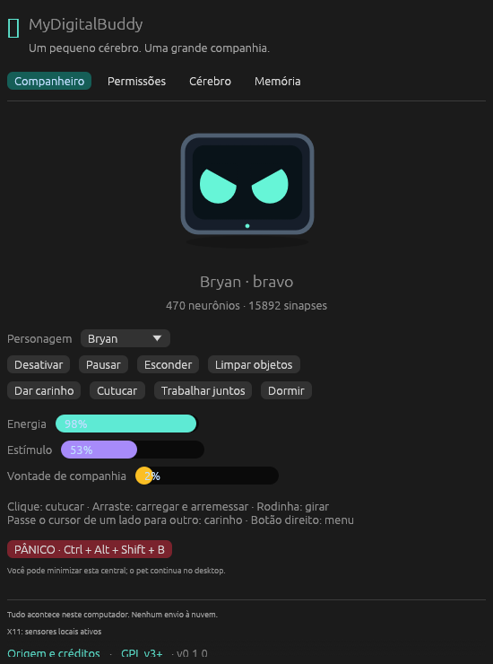

# MyDigitalBuddy

Um companheiro de desktop local, reimplementado em **Rust**, com rede neural pulsada de 470 neurônios, emoções, personalidade, memória e física 2D.

Este é um repositório novo, com implementação Rust; não exige Python, NumPy, Qt, servidor, LLM ou GPU de IA.

**Versão inicial de migração.** Os testes numéricos não demonstram paridade completa do aplicativo. A interface foi reescrita e as integrações nativas precisam de validação no desktop de destino. Veja [o relatório de validação](docs/VALIDATION.md) e [as diferenças](docs/MIGRATION.md).



## O que faz

- **Cérebro LIF:** 30 canais sensoriais, 15 motores, habituação, adaptação, inibição e sinapses plásticas.
- **Personalidade:** Bryan, Jorge, Bia, Sophia e definições personalizadas em JSON, com memória separada.
- **Interação:** cutucada, carinho por movimento do cursor, arraste, arremesso e giro.
- **Corpo:** gravidade, quique, rotação e pouso nas janelas do desktop.
- **Brincadeira:** bolinha arrastável, chutes, arremessos e papel na revolução.
- **Comportamento:** notebook, pedidos de trabalho, sono, protestos, cantinho, perdão e memória de fugas.
- **Travessuras:** bilhetes e imagens locais opcionais, escolhidos por aprendizado contextual.
- **Controle:** central minimizável, menu no pet, permissões, monitor neural, painel de protesto e pânico persistente.

## Compilar e executar

Use o [Rust oficial](https://www.rust-lang.org/tools/install), com Cargo. A toolchain do projeto é **1.99.1**; o pacote declara MSRV 1.95 por causa do eframe.

```bash
git clone https://github.com/paulosantanna/MyDigitalBuddy.git
cd MyDigitalBuddy
cargo run --release --locked
```

No Windows, abra `MyDigitalBuddy.exe` na pasta do projeto. É o programa: não abre console e não depende do `.bat`. O ícone do arquivo é o rosto da Sophia. Ele usa apenas bibliotecas do Windows, inclusive `OPENGL32.dll`.

Para gerar esse arquivo de novo, use o target **MSVC** com o componente de compilação C++ do Visual Studio Build Tools. Se `link.exe` não existir e o GCC do MinGW-w64 estiver no `PATH`, `run.ps1` compila e copia o resultado para `MyDigitalBuddy.exe`:

```powershell
powershell -ExecutionPolicy Bypass -File .\run.ps1
```

No macOS, instale as Command Line Tools do Xcode. No Ubuntu/Debian:

```bash
sudo apt-get install build-essential pkg-config libx11-dev libxkbcommon-dev \
  libwayland-dev libxi-dev libxcursor-dev libxrandr-dev libgl1-mesa-dev
cargo run --release --locked
```

No Linux, prefira uma sessão **X11**. Em Wayland, sensores e posicionamento de janelas podem ser limitados pelo compositor. XWayland pode permitir parte dessas funções. OpenGL é usado apenas para desenhar a interface.

O binário fica em `target/release/mydigitalbuddy` ou `mydigitalbuddy.exe`. As definições básicas são embutidas. Pastas `pets/` e `assets/` ao lado do binário são opcionais para personalização. O workflow de CI prepara pacotes por sistema após os testes.

## Usar

| Ação | Resultado |
|---|---|
| Clique rápido | Cutucada |
| Cursor de um lado para o outro sobre o pet | Carinho |
| Arrastar e soltar | Carregar ou arremessar |
| Rodinha sobre o pet | Girar |
| Botão direito no pet | Menu de comandos |
| Arrastar notebook ou placa | Reposicionar objeto |
| Soltar o pet diante da placa | Cantinho do castigo |
| Clicar em bilhete ou imagem | Dispensar objeto |
| **Ctrl + Alt + Shift + B** | Desativar e persistir o pânico |

Travessuras começam desligadas. Minimizar ou fechar a central manda a janela para a bandeja; o companheiro continua no desktop. O ícone da bandeja abre a central de novo, e abrir o programa outra vez também traz a janela de volta. **Sair** encerra o programa. Em Permissões, **Iniciar com o Windows** (On/Off) sobe o companheiro já na bandeja no próximo login. Depois do pânico, reative pela central. Se o sistema não disponibilizar o atalho global, o botão de pânico da central continua disponível.

## Linha de comando

```bash
# Usar permissões salvas e abrir já na bandeja
cargo run --release --locked -- --direto

# Só a bandeja; o companheiro continua no desktop
cargo run --release --locked -- --tray

# Outro personagem e tempos de desenvolvimento
cargo run --release --locked -- --pet jorge --test-mode

# Simulação sem abrir janelas, com semente reproduzível e dados isolados
cargo run --release --locked --no-default-features -- \
  --headless 60 --seed 42 --data-dir ./memory-demo

# Conteúdo personalizado fora da pasta do executável
cargo run --release --locked -- --content-dir ./meu-conteudo

# Importar memória do legado, preservando os originais
cargo run --release --locked -- --data-dir ./memoria-importada \
  --pet bryan --import-legacy /caminho/para/Pestinha
```

A importação aceita a estrutura `memory/pets/<id>/` e o formato antigo de arquivos soltos. O destino do personagem deve estar vazio. Todos os candidatos são validados antes da escrita. A importação não altera nem exclui a origem; uma mudança no gerador aleatório impede equivalência numérica entre trajetórias nativas antigas e novas.

## Privacidade e memória

O runtime não contém cliente HTTP nem telemetria. Consulta somente nome do processo, ociosidade, cursor e geometria de janelas. Não solicita títulos ou conteúdo de janelas. A combinação do atalho de pânico é consultada sem gravar histórico de teclas. A inferência de digitação usa ociosidade e movimento do cursor; não captura texto.

Dados ficam em `%LOCALAPPDATA%/MyDigitalBuddy` no Windows, `~/Library/Application Support/MyDigitalBuddy` no macOS, e `$XDG_DATA_HOME/mydigitalbuddy` ou `~/.local/share/mydigitalbuddy` no Linux. Use `--data-dir` ou `MYDIGITALBUDDY_DATA_DIR` para escolher outra pasta.

JSON é validado antes de restaurar; gravações usam temporário, sincronização e rename. Um lock do SO impede dois processos de escrever na mesma pasta. A rotina é opcional e grava apenas categorias agregadas por minuto. Leia [PRIVACIDADE.md](PRIVACIDADE.md).

## Testes e rastreabilidade

```bash
cargo fmt --all --check
cargo clippy --locked --all-targets --all-features -- -D warnings
cargo test --locked --all-targets
cargo test --locked --no-default-features --all-targets
cargo build --release --locked
```

Os testes consomem oráculos executados no Python original, congelados como JSON. **Python não é necessário para executar os testes.** O teste neural injeta o modelo original e os mesmos draws para comparar as equações, isolando a diferença entre geradores aleatórios.

- [Especificações extraídas](_reversa_sdd/inventory.md)
- [Análise técnica e fórmulas](_reversa_sdd/code-analysis.md)
- [Arquitetura alvo](_reversa_sdd/migration/target_architecture.md)
- [Critérios de paridade](_reversa_sdd/migration/parity_specs.md)
- [Proveniência e hashes](docs/PROVENANCE.json)
- [Migração e diferenças](docs/MIGRATION.md)
- [Validação executada](docs/VALIDATION.md)

## Licença

**GPL-3.0-or-later**. Consulte [LICENSE](LICENSE).
